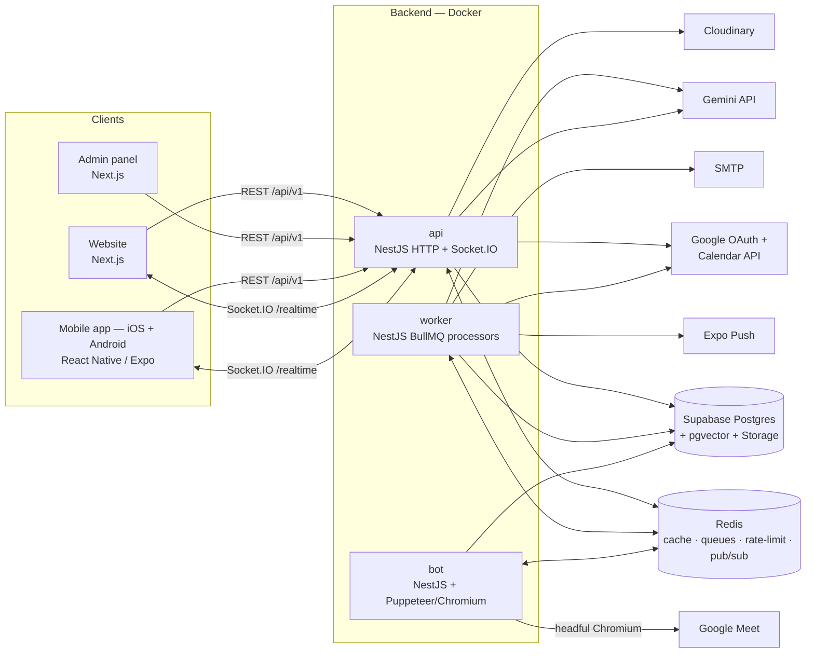
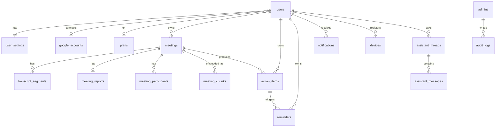
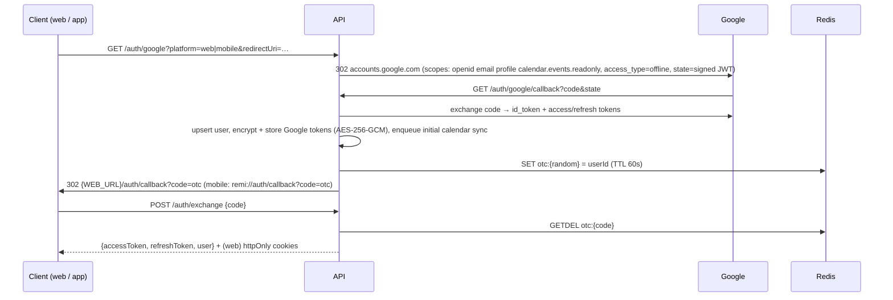
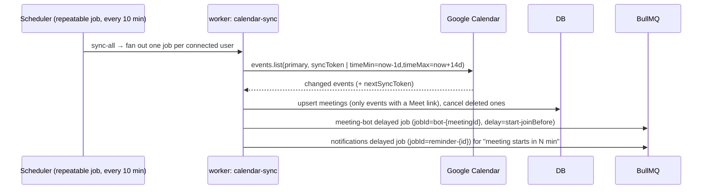

# Remi — High-Level Design

Remi is an AI meeting assistant. It connects to a user's Google Calendar, sends a notetaker bot into their
Google Meet calls, turns the conversation into a report (summary, chapters, action items, key questions,
sentiment/engagement scores), remembers commitments, and reminds the user of what is coming up.

Three client products share one backend:

| Product      | Tech                         | Default URL               | Audience         |
|--------------|------------------------------|---------------------------|------------------|
| Website      | Next.js (App Router)         | `http://localhost:3000`   | End users        |
| Admin panel  | Next.js (App Router)         | `http://localhost:3001`   | Operators/editors|
| Mobile app (iOS + Android) | React Native (Expo), one codebase | simulator / emulator / device | End users |
| Backend API  | NestJS + Prisma + Redis + Supabase + Gemini (Docker) | `http://localhost:4000/api/v1` | all clients |

**Everything user-visible is dynamic.** Brand name, logos, colours, landing-page sections, navigation, banners,
pricing plans, CMS pages, mobile onboarding, feature flags, AI model and prompts, bot behaviour and
notification templates are stored in Postgres and edited from the admin panel. Clients never hard-code them.

---

## 1. Goals and non-goals

**Goals**
- Google sign-in on web, iOS and Android, one account across all three.
- Automatic calendar sync, so the bot joins meetings with no manual step.
- Reliable post-meeting AI processing with retries; reports land within a few minutes of the call ending.
- "Memory": semantic search / Q&A across all of a user's past meetings.
- Proactive reminders (upcoming meetings, due action items, AI-detected commitments, daily digest) via push,
  in-app and email.
- Admin-driven content and configuration with cache invalidation, so changes are live in seconds with no deploy.
- Horizontally scalable: API, queue workers and bot runners scale independently.

**Non-goals (v1)**
- Zoom / Teams bots (the data model supports `platform`, but only the Google Meet runner is implemented).
- Live audio recording / speaker diarisation from raw audio inside calls (we capture Meet's live captions; see §9).
- Billing/payments (plans exist for display and limits; checkout is out of scope).

---

## 2. System context



---

## 3. Components

### 3.1 Backend (NestJS modular monolith, three entrypoints)

One codebase and one Docker image family, started three ways:

| Process  | Entrypoint      | Responsibility                                                                 | Scales by                     |
|----------|-----------------|---------------------------------------------------------------------------------|-------------------------------|
| `api`    | `src/main.ts`   | REST API, Swagger (`/docs`), Socket.IO gateway, OAuth callbacks, enqueues jobs  | CPU / RPS (stateless)         |
| `worker` | `src/worker.ts` | BullMQ processors: calendar sync, AI processing, reminders, notifications, digest | queue depth                 |
| `bot`    | `src/bot.ts`    | BullMQ `meeting-bot` processor: drives Chromium into Google Meet, streams captions | concurrent meetings (1–2 per container) |

All three processes run from the same `remi-backend` image (see §11); they differ only in the start command, so they
scale independently as separate containers while always running identical code.

**Module map** (`backend/src`)

```
config/            typed env config + validation
common/            filters, interceptors (envelope, logging), guards, decorators, pipes, utils (crypto, pagination)
infra/             supabase, redis (cache), queue (BullMQ registration), gemini, google, cloudinary, mail, push
modules/
  auth/            Google OAuth, JWT issue/verify, refresh-token rotation, user guard
  users/           profile, user settings
  integrations/    Google Calendar connection status / manual sync / disconnect
  calendar/        calendar sync service + processor (worker)
  meetings/        meetings CRUD, transcript, upload, bot control
  bot/             bot scheduler (api/worker) + Meet runner (bot process only)
  ai/              report pipeline (Gemini), embeddings, prompt rendering
  assistant/       Ask-AI (RAG over meeting_chunks)
  action-items/
  reminders/       CRUD + delayed-job scheduling
  notifications/   in-app notifications, Socket.IO gateway, delivery processor (push/email)
  devices/         Expo push tokens
  dashboard/       home aggregate
  analytics/       overview aggregates (SQL RPC)
  content/         app_settings, sections, pages, navigation, banners, plans, prompts, templates
  public/          aggregated public config (cached)
  media/           Cloudinary upload + media library
  admin/           admin auth, admin users, users/meetings management, dashboard, audit log, system/queues
  health/          liveness/readiness (Redis, Supabase)
```

### 3.2 Data stores

- **Supabase Postgres** — system of record, accessed through **Prisma** (`PrismaService`, shared by api, worker and bot).
  Runtime queries use the pooled connection (`DATABASE_URL`, Supavisor transaction mode); migrations use the direct
  connection (`DIRECT_URL`). Repositories map Prisma models to the contract's DTOs; multi-row writes (token rotation,
  report + action items + participants, reorders) run in `$transaction`. Heavy aggregates and vector search are SQL
  functions called with typed `$queryRaw` tagged templates. RLS is enabled on every table with no policies, so
  Supabase's anon/auth keys (PostgREST) can read nothing; Prisma connects as the table owner.
- **Prisma Migrate** owns the schema. `schema.prisma` mirrors the tables; features Prisma cannot express (RLS,
  `updated_at` triggers, CHECK constraints, partial/trigram/HNSW indexes, SQL functions) live as raw SQL inside the
  migration files.
- **pgvector** — `meeting_chunks.embedding vector(768)` (Gemini `gemini-embedding-001`, 768 dims; `Unsupported` in
  Prisma, written and read via raw SQL) with an HNSW index for Ask-AI retrieval.
- **Supabase Storage** — bucket `recordings` (private) for uploaded audio/transcripts, accessed with `supabase-js`
  (Storage only); the API ensures the bucket exists on boot.
- **Redis** — BullMQ queues, response cache for public config (`cfg:*`), rate-limit counters, OAuth one-time codes,
  Socket.IO adapter pub/sub (so any api replica can emit to any user).
- **Cloudinary** — all brand/CMS media (logos, banners, section images). Dummy cloud `demo` in development.

### 3.3 Clients

- **Website** — public marketing pages (landing, pricing, CMS pages) rendered server-side from `/public/*` with
  `revalidate` + tag-based on-demand revalidation; authenticated app under `/dashboard`, `/analytics/*`, etc.
  Theme colours become CSS variables at the root layout, so the whole UI follows the admin's colours.
- **Admin panel** — separate Next.js app, separate auth (email + password, RBAC), separate cookie names.
- **Mobile app (iOS + Android)** — one Expo + expo-router codebase; platform differences (date pickers, shadows, keyboard, action sheets, push permissions, store URLs) are isolated in small `Platform.select` helpers. Bootstraps from `/public/config?platform=mobile` (theme, tabs, onboarding,
  maintenance/force-update), Google login via system browser + deep link, Expo push notifications.

---

## 4. Data model (summary)

Prisma schema: `backend/prisma/schema.prisma`. Migrations (DDL incl. SQL-only features):
`backend/prisma/migrations/*/migration.sql`. Seed: `backend/prisma/seed.sql` (run by `prisma db seed`).



CMS / config tables: `app_settings` (typed JSON per key), `content_sections`, `cms_pages`, `navigation_items`,
`banners`, `plans`, `media_assets`, `ai_prompts`, `notification_templates`, `broadcasts`.
Auth: `auth_sessions` (hashed refresh tokens for users and admins, rotation families).

Conventions: UUID PKs (`gen_random_uuid()`), `timestamptz` everywhere (UTC), `snake_case` in SQL and
`camelCase` in JSON, status columns are `text` + `CHECK` (easier to evolve than PG enums), `updated_at`
maintained by trigger.

---

## 5. Key flows

### 5.1 Google sign-in (web and mobile)

The backend owns the whole OAuth exchange so it can keep a **Google refresh token** (offline access to Calendar)
regardless of which client the user signed in from.



- Access token: JWT, 15 min. Refresh token: opaque random 256-bit, 30 days, **stored hashed** in `auth_sessions`,
  rotated on every refresh. Reusing an already-rotated token revokes the whole family (theft detection).
- Web uses httpOnly cookies (`remi_at`, `remi_rt`; `SameSite=Lax`, `Secure` in prod, `COOKIE_DOMAIN` shared by
  web + api subdomains). Mobile keeps tokens in `expo-secure-store` and sends `Authorization: Bearer`.
- Admins log in with email + password (bcrypt), separate JWT secret/audience, cookies `remi_admin_at` / `remi_admin_rt`.
- `redirectUri` for mobile is validated against `MOBILE_REDIRECT_ALLOWLIST` (`remi://`, `exp://`) — no open redirects.

### 5.2 Calendar sync → bot scheduling



- Idempotent: deterministic job IDs (`bot-{meetingId}`, `reminder-{reminderId}`; BullMQ forbids `:` in custom ids), so a re-sync moves a job instead of
  duplicating it. Time changes → remove + re-add.
- Bot eligibility comes from `user_settings.auto_join` (`all` / `owned` / `none`) and the per-meeting `auto_join` toggle.
- An expired `syncToken` (HTTP 410) falls back to a full window sync.

### 5.3 Bot in the meeting → report → reminders

```mermaid
sequenceDiagram
  participant Q as BullMQ meeting-bot
  participant B as bot process
  participant GM as Google Meet
  participant DB
  participant AQ as BullMQ ai-processing
  participant WK as worker: ai
  participant G as Gemini
  Q->>B: join(meetingId)
  B->>GM: open URL in Chromium, set name, mute mic/cam, "Ask to join"
  B->>DB: status=waiting_room → in_progress (emit meeting:updated)
  B->>GM: enable captions, MutationObserver on caption DOM
  loop every few seconds
    B->>DB: batch insert transcript_segments
  end
  B->>B: leave when meeting ends / alone > N min / max duration
  B->>DB: status=processing, duration
  B->>AQ: process(meetingId)
  AQ->>WK: process
  WK->>G: generateContent(prompt `meeting_report`, transcript) → JSON (responseSchema)
  WK->>DB: meeting_reports, action_items, meeting_participants (talk time computed locally)
  WK->>DB: reminders for commitments/due items + delayed notification jobs
  WK->>G: embed chunks → meeting_chunks
  WK->>DB: status=completed; notification "Report ready" (push + in-app + socket)
```

Failures: every stage is a BullMQ job with exponential backoff (AI: 5 attempts). Bot failures (not admitted, URL
invalid, Meet blocked) set `status=failed` with `failure_reason` and notify the user. Admins can re-run AI
processing from the admin panel (`POST /admin/meetings/:id/reprocess`).

**Uploads.** `POST /meetings/upload` accepts audio (mp3/m4a/wav/webm) or a transcript (txt/vtt/srt). Audio is stored in
Supabase Storage, sent to the Gemini Files API for transcription with speaker labels, then goes through the same
pipeline.

### 5.4 Reminder delivery

`reminders` rows are the source of truth; BullMQ holds a delayed job per pending reminder (`jobId=reminder-{id}`).
On fire, the worker re-reads the row (skips it if cancelled or changed), renders the `notification_templates` entry,
and fans out to the user's channels:
- **in_app** → `notifications` row + Socket.IO `notification:new` to room `user:{id}`
- **push** → Expo Push API for each registered device (invalid tokens are pruned)
- **email** → SMTP (nodemailer), if enabled globally and by the user

A repeatable `digest` job runs hourly and sends the daily digest to users whose local hour equals `digest_hour`.

### 5.5 Ask AI (meeting memory)

1. Embed the question (`gemini-embedding-001`, 768 dims).
2. `match_meeting_chunks(user, embedding, k=8, meeting?)` via Prisma `$queryRaw` → top chunks (cosine).
3. Gemini answers with prompt `assistant_answer`, given only those chunks plus meeting titles and dates, and cites sources.
4. Store the Q&A in `assistant_messages`; return the answer and `sources[]` (meetingId, title, startAt, snippet).

### 5.6 Admin content change → clients

```mermaid
sequenceDiagram
  participant AD as Admin panel
  participant API
  participant DB
  participant R as Redis
  participant W as Website
  AD->>API: PUT /admin/settings/theme
  API->>DB: update + audit_logs row
  API->>R: DEL cfg:* (public config cache)
  API--)W: POST {WEB_URL}/api/revalidate (secret, tags=[config]) — best effort
  Note over W: Next.js revalidates the tagged fetches; new colours/logo on next request
  Note over API: Mobile refetches /public/config on app foreground (ETag → 304 when unchanged)
```

---

## 6. Queues

| Queue              | Producer              | Consumer | Job id                 | Retry               | Notes                          |
|--------------------|-----------------------|----------|------------------------|---------------------|--------------------------------|
| `calendar-sync`    | repeatable, api       | worker   | `sync-{userId}`        | 3, exp 30s          | `sync-all` every 10 min fans out |
| `meeting-bot`      | calendar-sync, api    | bot      | `bot-{meetingId}`      | 1 (no auto re-join) | concurrency `BOT_CONCURRENCY`  |
| `ai-processing`    | bot, upload, admin    | worker   | `ai-{meetingId}`       | 5, exp 60s          | Gemini rate limits             |
| `notifications`    | reminders, ai, admin  | worker   | `reminder-{id}` / auto | 3, exp 10s          | delayed jobs for reminders     |
| `digest`           | repeatable hourly     | worker   | `digest-{yyyyMMddHH}`     | 2                   | fan-out by user timezone       |

Completed jobs are trimmed (`removeOnComplete: 1000`); failed jobs are kept for 7 days and can be inspected and retried from
**Admin → System**.

---

## 7. Caching

| Key                         | Content                                      | TTL     | Invalidation                         |
|-----------------------------|----------------------------------------------|---------|--------------------------------------|
| `cfg:public:{platform}`     | aggregated public config + ETag hash         | 10 min  | any admin write to CMS/settings      |
| `cfg:sections:{page}:{plat}`| content sections                             | 10 min  | section writes                       |
| `cfg:page:{slug}`           | CMS page                                     | 10 min  | page writes                          |
| `cfg:plans`                 | active plans                                 | 10 min  | plan writes                          |
| `cfg:settings:{key}`        | private settings (ai, bot, notifications)    | 5 min   | settings writes (used by workers)    |
| `otc:{code}`                | one-time OAuth exchange code → userId        | 60 s    | consumed with GETDEL                 |
| `rl:*`                      | rate-limit counters                          | window  | —                                    |

Invalidation is centralised in `ContentCacheService.invalidate(scope)`, which every admin write path calls.

---

## 8. Security

| Area | Controls |
|------|----------|
| Transport / headers | HTTPS only in production (HSTS); helmet on the API; CSP, `frame-ancestors 'none'`, nosniff, strict Referrer-Policy and Permissions-Policy on web and admin; admin is `noindex`. Strict CORS allowlist (`CORS_ORIGINS`, never `*`) with credentials only for listed origins. |
| Authentication | Short-lived JWTs (HS256 pinned; `iss`/`aud`/`typ` verified; separate secrets and audiences for users and admins, so a user token never passes the admin guard). Opaque refresh tokens stored as SHA-256 hashes, rotated on every use; reusing a rotated token revokes the whole family and is logged as a security event. httpOnly + SameSite cookies for web and admin; `expo-secure-store` on mobile. |
| OAuth | Signed, expiring `state` (platform, redirect URI, PKCE challenge); exact-match allowlist for mobile redirect URIs (no open redirects); single-use one-time codes (Redis `GETDEL`, 60 s). **PKCE between the mobile app and the API**, because custom schemes can be hijacked by other apps. |
| Admin accounts | bcrypt (cost 12); per-IP and per-email login throttling with temporary lockout; generic error messages and timing-safe handling of unknown emails; sessions revoked on password, role or status change; the last active super admin cannot be removed or demoted. |
| Authorization | Every user-owned query is scoped by `userId` in the repository layer; another user's resource returns `404`, so IDs cannot be enumerated. Admin RBAC: `super_admin` > `admin` > `editor` (content only) > `viewer` (read only). Socket.IO authenticates the handshake, and the server alone assigns rooms. |
| Input validation | Global `ValidationPipe` (whitelist, forbidNonWhitelisted, transform) with length limits on every DTO; UUID route params; zod schemas per `app_settings` key; 1 MB JSON body limit. URLs coming from admins or users must be `https:`, relative, `mailto:` or `remi://`; `javascript:` and `data:` are rejected. Theme values (hex colours, font names) are validated, because clients inject them into CSS. The bot only accepts `https://meet.google.com/xxx-xxxx-xxx` URLs. |
| Uploads | Real file type detected from magic bytes against an allowlist, size limits, server-generated storage names; SVG is rejected or sanitised. |
| Output safety | Clients render markdown with raw HTML disabled and pass every dynamic link through `safeUrl`; email templates HTML-escape all variables. Transcripts are delimited as untrusted data in prompts, and model output is schema-validated and never executed. |
| Data at rest | Google tokens encrypted with AES-256-GCM (`ENCRYPTION_KEY`, 32 bytes). Database URLs, Supabase service key and API keys exist only server-side; production boot fails on weak or example secrets. Raw SQL only through Prisma tagged templates (never `*Unsafe` with external input). |
| Bot isolation | Fresh temporary browser profile per meeting; main-frame navigation limited to Google origins; no downloads; runs as a non-root container user. |
| Abuse | Redis-backed rate limits: global 120 req/min/IP, auth 10/min, Ask-AI 20/min/user, plus plan quotas (`PLAN_LIMIT_REACHED`). |
| Audit and privacy | Every admin mutation writes `audit_logs` (admin, action, entity, diff, IP, user agent). Users can disconnect Calendar (token revoked at Google) and delete their account (cascade delete). |

### 8.1 Error handling

- Services throw typed `AppException`s (code + HTTP status). One global filter turns every error — validation,
  Prisma (`P2002` → 409, `P2025` → 404), upload limits, throttling, JWT, unknown — into the contract's `ApiError`.
  5xx responses carry a generic message plus `requestId`, never stack traces, SQL or provider error bodies.
- Calls to Google, Gemini, Cloudinary, Expo, SMTP and Storage go through one wrapper: timeouts, jittered retries for
  retryable failures only (network, 429, 5xx), and mapping to `UPSTREAM_ERROR`. A revoked Google grant
  (`invalid_grant`) disconnects the integration and notifies the user instead of retrying forever.
- Gemini output is validated; on failure the call is repaired once and then fails the job with a clear reason.
- Jobs separate retryable from permanent failures (`UnrecoverableError`); after the last attempt the domain row records
  the failure (`meetings.failure_reason`, `reminders.failure_reason`) and the user is notified where relevant.
- The bot names each step (navigate, prejoin, join, admission, captions, capture, leave), always closes the browser, and
  saves captured segments before failing.
- Process-level handlers log fatal errors and shut down gracefully (HTTP server, workers, Redis, Prisma, browser).
- Clients: error boundaries per route segment; friendly messages per error code; the `requestId` is shown as a
  "Reference" on unexpected errors; no retries on 4xx; validation details mapped onto form fields; offline detection on mobile.

---

## 9. Reliability, scaling and known limits

- API is stateless → scale replicas behind a load balancer; Socket.IO uses the Redis adapter.
- Workers scale on queue depth; bot containers scale with concurrent meetings (each Chromium needs ~300–500 MB RAM).
- Graceful shutdown: workers finish their current jobs; the bot leaves the call cleanly on SIGTERM and still enqueues AI processing.
- **Google Meet bot caveats**: the bot joins as a guest, so the host must admit it (`waiting_room` status,
  `waitingRoomTimeoutMinutes`). Transcripts come from Meet's live captions — the bot does not record audio, and the
  caption language follows the meeting. Meet's DOM changes over time, so the CSS selectors live in
  `app_settings.bot.selectors` and can be hot-fixed from the admin panel without a deploy.
- **Google OAuth verification**: `calendar.events.readonly` is a sensitive scope. Unverified apps are limited to 100 test users.
- **Gemini**: model names, temperature and prompts are admin-configurable (`app_settings.ai`, `ai_prompts`), so models
  can be upgraded without a deploy. Responses use JSON mode + `responseSchema` and are validated before saving.

---

## 10. Observability

- Structured JSON logs (pino; pretty in development) with a request id (`X-Request-Id`, echoed on every response and
  in error bodies) bound to every log line. The id travels into BullMQ jobs as `correlationId`, so one request can be
  traced through api → worker → bot.
- Log levels: 5xx `error` with stack and cause chain; expected 4xx `warn`/`debug`; jobs log start, completion and
  failure with queue, job id, attempt and duration; security events (token reuse, failed PKCE, login lockouts) under a
  `security` tag.
- Redaction: authorization headers, cookies, passwords, tokens, auth codes, PKCE verifiers, API keys and encrypted
  fields are redacted. Transcripts, summaries, prompts and message bodies are never logged; only ids and lengths are.
- Clients use a small `logger` with a single `reportError` hook, ready for Sentry or a similar service.
- `/api/v1/health` (liveness) and `/api/v1/health/ready` (Redis + Supabase).
- Queue metrics on Admin → System (waiting/active/failed/delayed per queue, retry failed).
- Admin dashboard KPIs: signups, meetings processed, failures, reminders sent.

---

## 11. Deployment

```
docker compose up -d --build                      # hosted Supabase: redis, migrate (one-off), api, worker, bot
docker compose --profile local-db up -d --build   # + local Postgres (pgvector) instead of Supabase
```

Everything runs from **one image, `remi-backend:latest`**, built once from `backend/Dockerfile`. It contains the compiled
app, production dependencies, the Prisma CLI and migrations, and Chromium + Xvfb for the bot. Each service starts the
same image with a different command, and all containers belong to the single `remi` compose project.

| Service  | Image                | Command                     | Ports | Depends on        |
|----------|----------------------|-----------------------------|-------|-------------------|
| postgres | pgvector/pgvector:pg16 (profile `local-db`) | —    | 5432  | —                 |
| redis    | redis:7-alpine       | —                           | 6379  | —                 |
| migrate  | `remi-backend`       | `prisma migrate deploy` (exits) | — | postgres (local-db) |
| api      | `remi-backend`       | `node dist/main.js`         | 4000  | redis, migrate    |
| worker   | `remi-backend`       | `node dist/worker.js`       | —     | redis, migrate    |
| bot      | `remi-backend`       | `xvfb-run node dist/bot.js` | —     | redis, migrate    |

One image means one build, one tag to push and roll back, and no version skew between api, worker and bot. The cost
is that api and worker containers also carry the Chromium layers (disk only; they never start a browser). If image
size matters more later, the Dockerfile can expose a slimmer `runtime` target without the browser for api/worker.

Supabase is external by default (hosted project); the `local-db` profile runs Postgres + pgvector in the same stack
for offline development (Supabase Storage uploads are disabled in that mode). `migrate` applies pending Prisma
migrations before the app containers start. Website and admin deploy as standard Next.js apps (Vercel / Node). The
mobile app builds for both stores with EAS (`eas build --platform ios|android`) or locally with `expo run:ios` /
`expo run:android`; push uses APNs (iOS) and FCM v1 (Android) through Expo Push.

Production topology: `app.example.com` (website), `admin.example.com` (admin), `api.example.com` (api), with
`COOKIE_DOMAIN=.example.com`.
